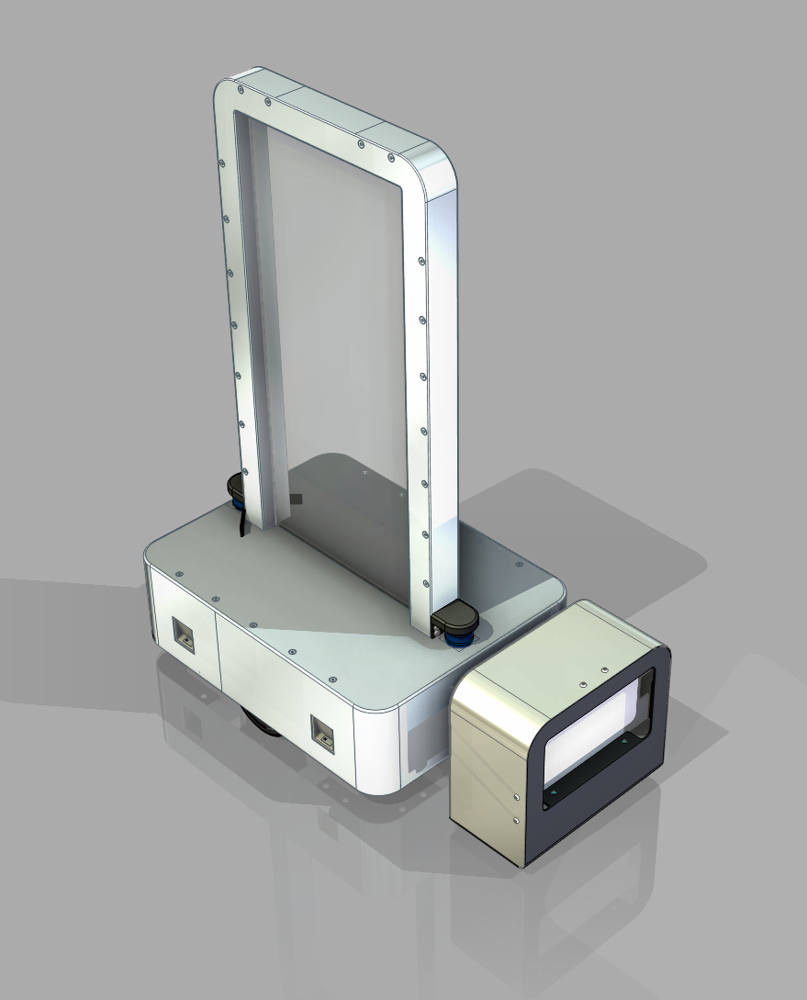

# 迎宾机器人

> 智能多功能迎宾引导机器人（2025 项目）

## 目录结构
- `Body/` -存放主要内容
- `Note`  -存放零时想法

## 使用方法（包括INDEX）

### 效果图

*迎宾小车 - 实物渲染效果*

---

### 主要功能
- **智能迎宾与引导**：语音交互 + 自主导航
- **信息查询与交互**：透明大屏显示 + 语音对话（支持数字人）
- **自主导航与避障**：导航雷达 + 多激光雷达全域感知（无盲区）
- **人脸识别**：双目摄像头支持身份验证
- **信息展示与播报**：大屏 + 音响一体化播报
- **自动充电**：充电刷块接触式自动补电，支持无人值守

---

### 设计亮点
- 底盘与悬挂创新结构设计（外部负载不压底盘，稳定性高）
- 四轮结构 + 可调节悬挂，保证全地形稳定不悬空
- 步科一体式 400W 电机
- 自动充电刷块系统
- 车体重心低，抗侧风与加速稳定性优秀

---

### 技术参数

| 项目              | 参数                          |
|-------------------|-------------------------------|
| 尺寸              | 623 × 480 × 1084 mm          |
| 重量              | ≈157kg（理论）                |
| 电池              | 48V 20Ah 三元锂               |
| 续航              | 一般使用 3h+，极限 1h45min    |
| 驱动              | 步科一体式 400W 电机          |
| 感知              | 导航雷达 + 多激光雷达 + 双目摄像头 |
| 充电方式          | 自动充电刷块 + 手动充电口     |

## 保留内容

### 学习许可与权利保留

- 本项目允许个人、学校和研究者进行非商业性的学习、研究和引用。
- 未经著作权人书面许可，不得将项目内容用于商业开发、产品制造、商业服务、商业宣传、投标交付、毕业设计成品交付或再授权。
- 不得删除作者、来源、版本历史和第三方许可证声明，不得将本项目或其衍生成果宣称为与作者无关的原创项目。
- 软件源码适用 [PolyForm Noncommercial 1.0.0](https://polyformproject.org/licenses/noncommercial/1.0.0/)；机械模型、PCB、原理图、图片、文档、Unity 工程和其他非软件资料适用 [CC BY-NC-ND 4.0](https://creativecommons.org/licenses/by-nc-nd/4.0/)。
- SE、SW、STEP/STP 及其他三维模型仅允许个人或学校进行非商业学习、评审和研究；未经著作权人书面许可，不得用于加工、打样、制造、销售、量产、投标、产品交付、商业宣传、改作或再授权。
- 第三方组件、模板、元件库、外购件模型和工具仍受其原始许可证约束；本声明不扩大作者对第三方内容的权利。

商业使用、产品化、公司内部长期使用、转让或排他性授权需另行取得著作权人的书面许可。